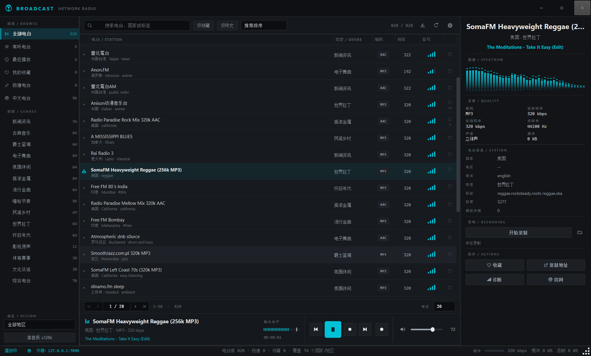
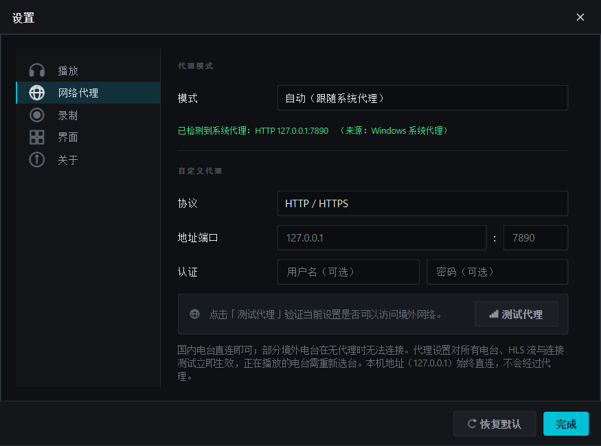
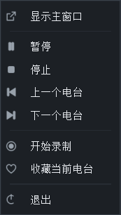
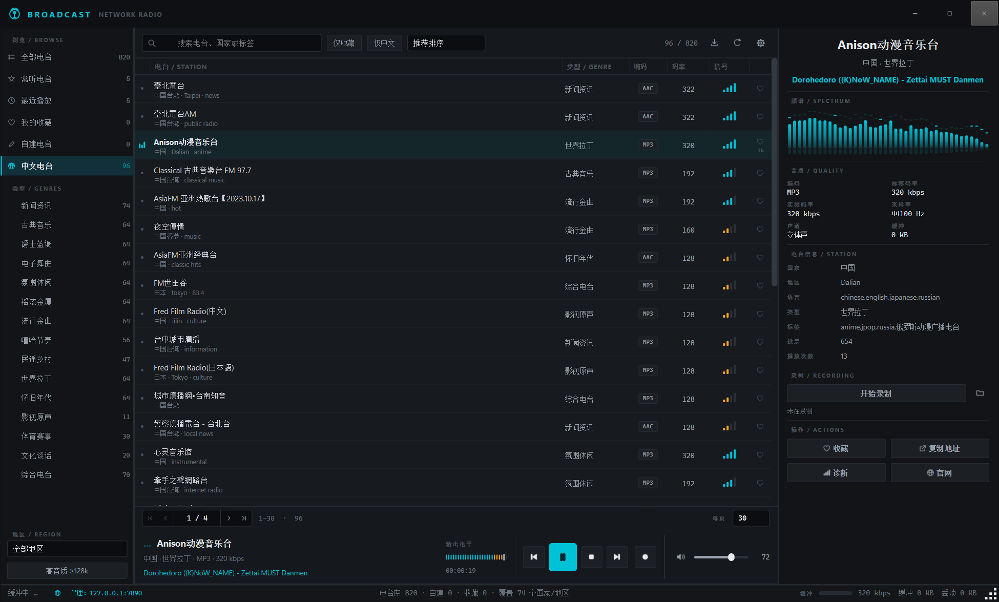
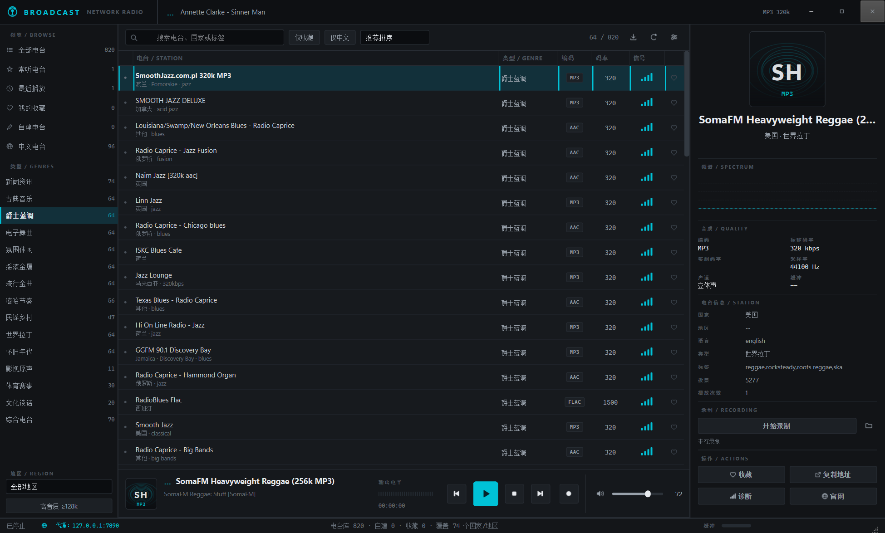
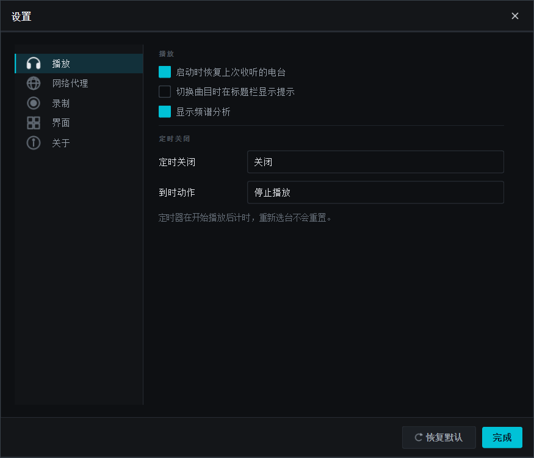
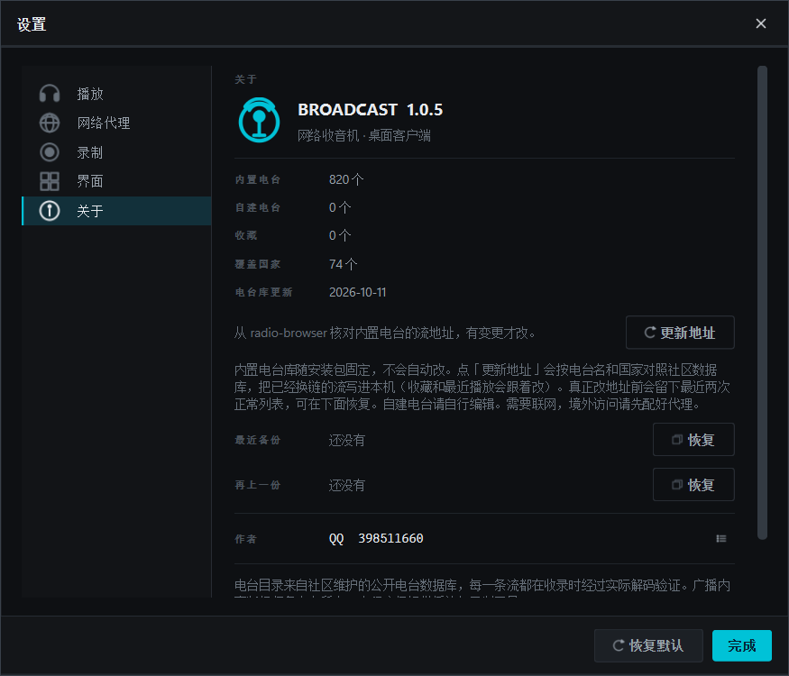
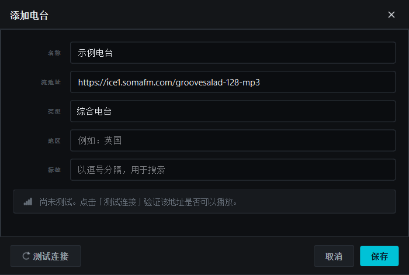

# BROADCAST — 网络收音机

一个面向桌面的网络收音机客户端。Python + PySide6 实现，界面为自绘的深色专业控制台风格。

**作者 QQ：398511660** · 项目主页：<https://github.com/martjay/network-radio>



---

## 快速开始

### 方式一：直接运行 exe（无需 Python）

从 [Releases](https://github.com/martjay/network-radio/releases) 下载，解压后运行 `Broadcast.exe`。

### 方式二：源码运行

**Windows：双击 `run.bat`** —— 会自动创建 uv 虚拟环境、安装依赖并启动程序。

首次运行需要 [uv](https://docs.astral.sh/uv/)：

```
winget install --id=astral-sh.uv -e
```

手动运行（任意平台）：

```bash
pip install -r requirements.txt
python main.py
```

可选：安装 [ffmpeg](https://ffmpeg.org/) 并加入 `PATH`，用于**录制**和 **HLS 电台**。
未安装时程序仍可正常播放绝大多数电台，只是录制功能不可用。

---

## 构建 exe

```bash
build_exe.bat            # 构建
build_exe.bat clean      # 先清理再构建
```

产出在 `dist\Broadcast\`，整个文件夹即分发包，复制到任意 Windows 机器即可运行，**不需要装 Python**。

构建流程分 6 步，其中两步是自动验证：

1. 创建 / 复用 uv 虚拟环境
2. 安装运行依赖与构建依赖（PyInstaller）
3. 源码导入自检
4. PyInstaller 打包
5. **`--selftest`** —— 在打包产物上验证资源路径、Qt 多媒体插件、FFmpeg 后端 DLL、
   numpy、电台库、代理模块、数据目录可写
6. **`--playtest`** —— 用打包后的解码器**真实播放一个电台**，确认频谱有能量

第 6 步是关键：它能抓住「源码能跑、打包后放不出声」这类只在冻结环境出现的问题。
网络不通时该步会给出警告但不判定构建失败。

两个诊断命令在源码下也可用：

```bash
python main.py --selftest          # 检查运行环境
python main.py --playtest [URL]    # 播放测试
```

---

## 代理

很多境外电台在直连时无法访问，所以代理是传输层的一等公民，而不是事后补丁。

**设置 → 网络代理**，三种模式：

| 模式 | 说明 |
|---|---|
| **自动（跟随系统代理）** | 读取系统代理设置，默认选项 |
| **不使用代理** | 全部直连 |
| **自定义代理** | 手动指定协议、地址、端口、认证 |



自定义模式支持 **HTTP / HTTPS** 与 **SOCKS5**，可选用户名密码认证。
设置面板内直接显示检测到的系统代理及其来源，并提供「测试代理」按钮验证连通性。

### 自动检测的来源

按优先级依次尝试：

1. 环境变量 `ALL_PROXY` / `HTTPS_PROXY` / `HTTP_PROXY`（含 `NO_PROXY` 例外列表）
2. **Windows** — 注册表 `Internet Settings`，支持 `ProxyEnable`、`ProxyServer`
   的多协议写法（`http=...;https=...;socks=...`）与 `ProxyOverride` 例外列表
3. **macOS** — `scutil --proxy`
4. **Linux** — GNOME `gsettings`

系统使用 **PAC 自动配置脚本**时无法自动解析，界面会明确提示并建议改用自定义模式。

### 覆盖范围

代理设置对**所有**网络路径生效：

- 全部电台流（含播放列表解析与重定向跟随）
- HLS 流
- 「测试代理」与「测试连接」
- 状态栏常驻显示当前代理（`代理：127.0.0.1:7890` / `代理：关闭`），点击可直达设置

本机地址（`127.0.0.1`）**始终直连**——音频解码器读取的是程序自己的本地中继，
这条链路绝不能走代理。

### SOCKS5

SOCKS5 是直接实现的（RFC 1928 + 用户名/密码认证），不依赖 PySocks，
因此程序没有额外的运行时依赖。

### ffmpeg 如何走代理

ffmpeg 各构建对代理的支持不一致，且没有可移植的 SOCKS5 选项。
因此程序在本地起一个 **CONNECT 代理（shim）**，让 ffmpeg 指向它，
由 shim 统一用与主程序相同的隧道代码转发——HTTP、HTTPS、SOCKS5、
认证三种组合行为完全一致。

---

## 功能

### 电台库
- 安装包内置 **820 个**经过 `ffprobe` 解码验证的核心电台（74 个国家/地区、21 个类型）
- 类型按台名 + 标签打分，**每个电台只进一类**：新闻、谈话、古典、爵士、蓝调、电子、氛围、摇滚、金属、流行、嘻哈、民谣、乡村、世界、拉丁、怀旧、影视、体育、文化、宗教；对不上的进综合。无标签时按国家兜底（拉美→拉丁，中东/南亚/北非等→世界），搜索可用中文类型名
- 设置 → 关于 → **同步电台库**：对照社区数据库，改已换链的地址，并把尚未收录的台按同一套规则分类后追加（只增不减、不设总上限，自建电台不动）
- 国家与语言显示中文名；电台信息里的国家、地区、语言、类型、标签可点击，立刻按该项筛选
- 96 个中文电台（中国大陆、香港、台湾），含 RTHK 1–8、臺北電台、警察廣播電台、河南戏曲广播等
- 支持 MP3、AAC、AAC+、HLS 四种流格式

### 播放
- 后台线程连接，界面全程不卡顿
- 自动解析 PLS / M3U / ASX 播放列表并跟随重定向
- 读取 ICY 元数据，实时显示「歌手 - 曲名」
- 解析音频帧头，显示**真实编码码率**、采样率、声道数
- 断流自动重连

### 音频可视化
- 40 段对数频谱分析仪（实时 FFT），带峰值保持与倒影
- 26 段电平表，含峰值保持与过载指示
- 频谱在低频段做了能量倾斜补偿，整体显示均衡而非单调下滑

### 录制
- 直接复制原始音频流，**不二次编码**，音质与电台播出完全一致
- 自动识别流格式并选择匹配的容器：MP3 流存为 `.mp3`，**Ogg/Opus 流存为 `.ogg`**，
  AAC 流存为 `.aac` —— 不会把 Opus 数据塞进 `.mp3` 里产生无法播放的文件
- 源格式与目标容器不兼容时自动转码（如存为 WAV / FLAC）
- 首尾帧对齐，录制文件可无损解码
- 可选择每次播放时自动录制

### 管理与界面
- 收藏、最近播放、常听电台、自建电台
- 多条件筛选：类型、地区、码率、中文、收藏、关键词搜索；搜索框随工具栏宽度伸缩
- 地区下拉限高并带滚动条，选中后可一键清除；点类型会先清掉国家过滤
- 列表分页，可输入页码直达；当前分类在该国家没有电台时，列表中央提供清空分类 / 清空国家
- 单击正在播放的电台名可复制台名；`Ctrl`+单击列表台名同样复制。底部播放条的定位按钮或 `Ctrl+L` 跳到当前播出的那一行（必要时会先放开筛选）
- 6 种排序方式（推荐、投票、音质、名称、国家、类型）
- 自建电台支持**连接测试**，添加前即可验证能否播放
- 实时连接诊断面板（上游地址、内容类型、实测码率、缓冲、丢帧）
- 定时关闭（15–120 分钟，可停止播放或退出程序）
- 收藏导出为 M3U 播放列表
- 无边框窗口，窗口状态与设置自动记忆
- 高清屏自适应：DPI 缩放、窗口大小与位置跨会话记忆

### 托盘
关闭窗口**不会退出程序**，而是最小化到托盘继续播放。

- 托盘图标右键菜单：显示主窗口、播放/暂停、停止、上一个/下一个电台、开始/停止录制、收藏当前电台、退出
- 双击托盘图标恢复窗口
- 鼠标悬停显示当前电台与正在播放的曲目
- 可在设置中关闭「关闭时最小化到托盘」，改为直接退出



### 图标

窗口、任务栏、托盘三处图标同源，都由标题栏那个信号塔标记按需光栅化生成：

- 程序内嵌 **10 种尺寸**（16–256 px），高分屏下不发虚
- 打包时生成多分辨率 `.ico` 并嵌入 exe，资源管理器与任务栏显示正确图标
- 设置了独立的 AppUserModelID，避免 Windows 把程序归到宿主进程而显示通用图标

<p>


</p>

### 快捷键

| 按键 | 功能 |
|---|---|
| `Space` | 播放 / 暂停 |
| `Ctrl` + `←` / `→` | 上一个 / 下一个电台 |
| `Ctrl` + `R` | 开始 / 停止录制 |
| `Ctrl` + `D` | 收藏当前电台 |
| `Ctrl` + `L` | 定位到正在播放的电台 |
| `Ctrl` + `F` | 聚焦搜索框 |
| `Ctrl` + `N` | 添加电台 |
| `Ctrl` + `E` | 导出收藏 |
| `Ctrl` + `,` | 打开设置 |
| `F11` | 最大化 / 还原 |

关闭窗口 = 最小化到托盘（可在设置中改为直接退出）。退出请用托盘菜单的「退出」。

---

## 界面

| 中文电台 | 爵士乐分类 |
|---|---|
|  |  |

**设置面板**（播放 / 网络代理 / 录制 / 界面 / 关于五页）



**关于**（作者与项目信息）



**添加电台**（含连接测试）



---

## 架构

```
main.py                 程序入口（含 --selftest / --playtest 诊断）
run.bat                 Windows 一键启动（uv 虚拟环境）
build_exe.bat           Windows 一键打包 exe
requirements.txt        运行时依赖
requirements-build.txt  构建依赖
packaging/broadcast.spec  PyInstaller 配置
radio/
  theme.py              设计令牌与全局样式表
  icons.py              全部图标（QPainter 矢量绘制，无字体图标、无 emoji）
  appicon.py            程序图标：窗口/任务栏/托盘，多分辨率 .ico 生成
  tray.py               系统托盘与右键菜单
  proxy.py              代理：系统检测、HTTP CONNECT、SOCKS5、ffmpeg shim
  net.py                流传输：TLS、ICY 解复用、播放列表解析、帧头解析、HLS
  relay.py              本地回环 HTTP 中继
  player.py             播放引擎、FFT 分析、状态机
  recorder.py           录制（ffmpeg 管线、格式自适应）
  taxonomy.py           类型关键词、打分、地区/类型配额（构建与同步共用）
  geo.py                国家、语言中文名
  catalog.py            电台库同步：改址 + 分类收录新台
  library.py            电台库与用户数据
  table.py              电台列表（模型 + 自绘委托）
  widgets.py            自绘控件（频谱、电平表、封面、导航、标题栏）
  dialogs.py            对话框（含网络代理设置、关于）
  main_window.py        主窗口
tools/                  电台库构建与测试脚本
assets/stations.json    电台库
assets/broadcast.ico    程序图标（打包时使用）
```

### 关于本地中继

程序**不把远程地址直接交给音频引擎**。Qt 在 Windows 上的多媒体后端使用系统 TLS 栈，
在部分机器上无法完成握手（`schannel` 错误 `0x8009030e`），会导致 HTTPS 电台全部无法播放。

因此由程序自己用 Python 的 TLS 栈拉取上游数据，去除 ICY 元数据后，通过
`http://127.0.0.1:<随机端口>/stream` 转发给解码器。这样做的额外收益：

- 解码器收到的是连续纯音频流，无需处理穿插的元数据块
- 录制只需把同一条数据流旁路写入文件
- 可以精确统计缓冲与丢帧

中继环形缓冲区采用**背压**设计：消费端跟不上时写入阻塞并传导至上游 socket，
使中继与解码器同步推进，直播延迟保持在数秒内，而不是无限缓冲。

---

## 电台库的构建

电台库不是手工整理的，而是采集后逐个验证生成的：

```bash
cd tools
python harvest.py         # 从 radio-browser.info 采集候选电台 -> candidates.json
python verify.py          # 用 ffprobe 逐个验证可播放性   -> verified.json
python build_stations.py  # 清洗、分类、均衡选样          -> ../assets/stations.json
```

- **采集**：按国家、类型、码率共 62 个查询，去重后约 6400 条
- **验证**：48 线程并发 ffprobe，要求真正解出音频包才算通过（6437 条中 5667 条通过，88%）
- **选样**：先按地区配额保底，再按类型均衡，避免少数高票西方国家电台挤占整个列表
- 安装包只带这一份验证过的核心表。用户本机点「同步电台库」时走同一套分类规则，从社区库补新台并改旧地址；新增条目以社区 `lastcheckok` 为准，本机不设条数上限

---

## 测试

```bash
python tools/selftest.py                # 单元测试：帧头解析、格式嗅探、容器选择、录制对齐
python tools/test_catalogue_sync.py     # 电台库：分类、配额选样、同步持久化与恢复
python tools/test_pagination.py         # 列表分页、页码跳转、空筛选提示
python tools/test_recording_formats.py  # 录制：MP3 / Ogg-Opus / AAC 三种流格式
python tools/test_opus_recording_ui.py  # 录制：Opus 电台在真实界面中的完整流程
python tools/test_folder_button.py      # 录音目录按钮（含目录不可写的降级）
python tools/test_tray_window.py        # 图标、托盘、关闭到托盘、窗口尺寸记忆、DPI
python tools/test_proxy.py              # 代理：解析、系统检测、隧道、真实电台播放、ffmpeg shim
python tools/test_proxy_ui.py           # 代理设置贯通到播放与连接测试
python tools/test_functional.py         # 端到端：在真实窗口中播放、分析、录制、收藏、持久化
python tools/test_dialogs.py            # 渲染全部对话框并截图
```

`test_functional.py` 会真实连接电台，验证频谱有能量、元数据到达、录制文件可解码等，
共 31 项检查。`test_proxy.py` 会使用本机代理验证隧道代码并对比直连结果。

---

## 说明

- **作者 QQ：398511660**
- 项目主页：<https://github.com/martjay/network-radio>
- 电台目录来自社区维护的公开电台数据库 [radio-browser.info](https://www.radio-browser.info/)
- 广播内容版权归各电台所有，本程序仅提供播放与录制工具
- 部分电台有地区限制，在特定网络环境下可能无法播放，可在设置中配置代理
